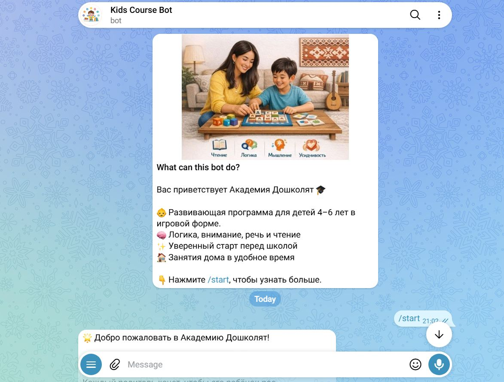
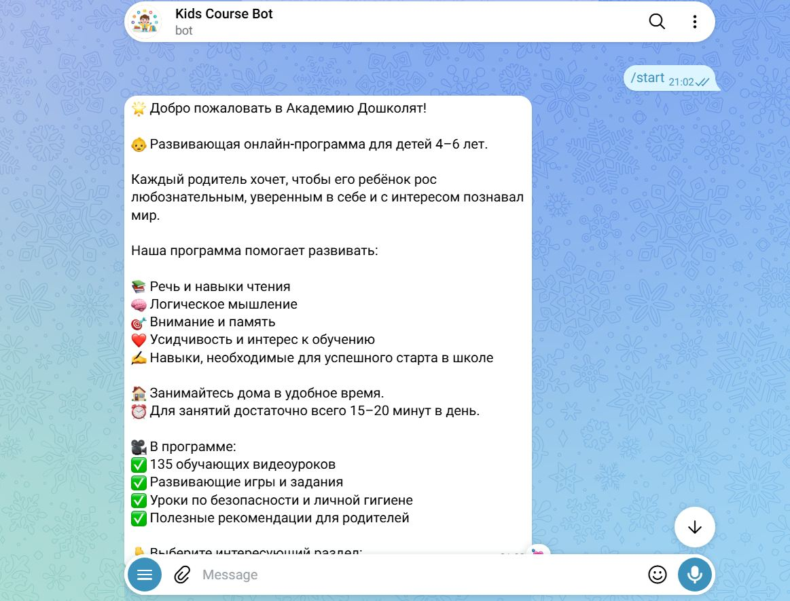
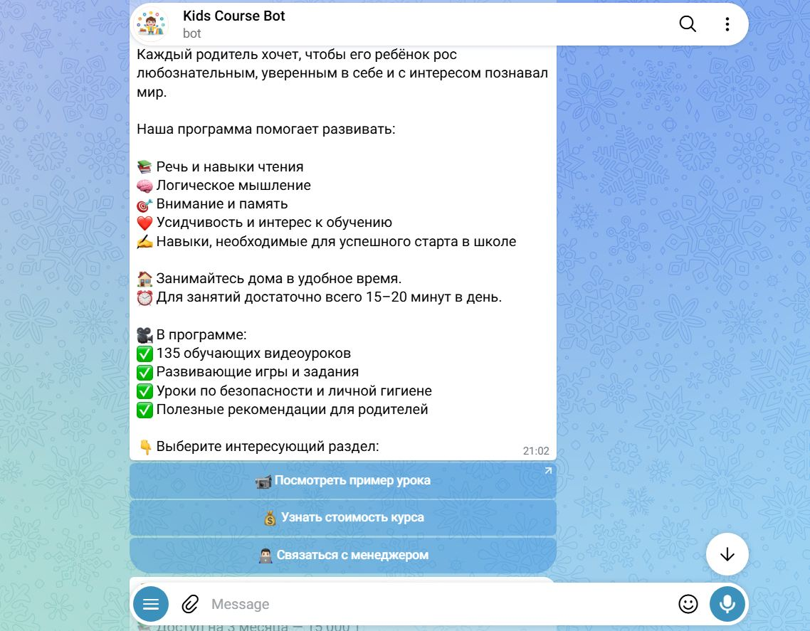
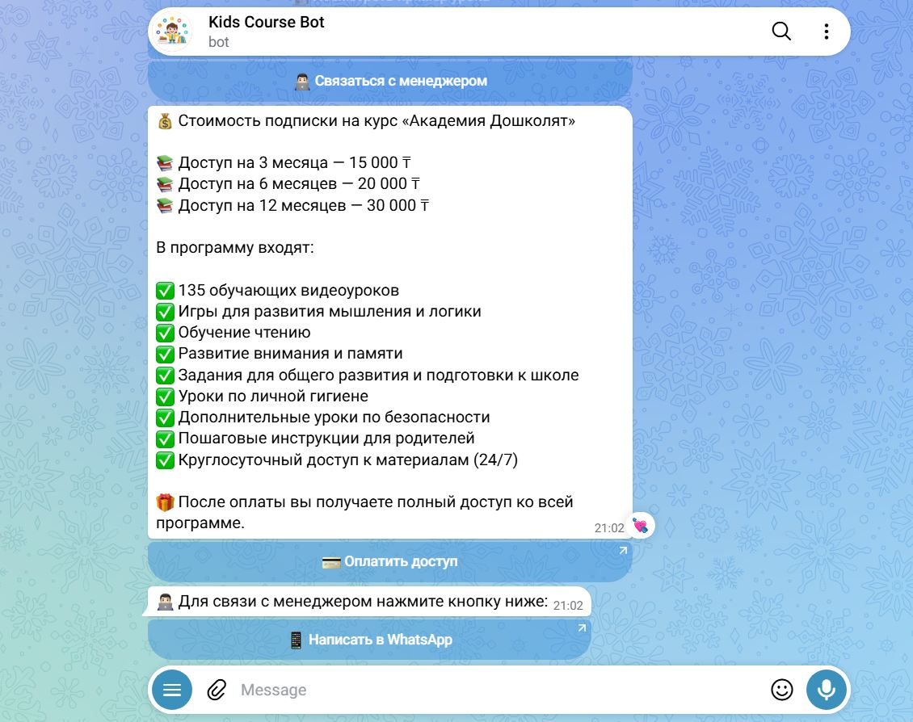

# 🎓 Academy of Preschoolers

**Educational Telegram Bot | Python & aiogram**

Academy of Preschoolers is a Telegram bot I developed independently to help parents explore an educational program designed for children aged 4–6.

The program includes 135 video lessons covering early reading, logical thinking, attention, safety, hygiene, and school readiness.

**My Role:** Independent Developer

**Technologies:** Python, aiogram, Telegram Bot API

## Key Features
- Interactive navigation through the bot
- Information about the educational program
- Access to sample lesson information
- Pricing and enrollment details
- Contact options for consultation

## Project Background
I developed this bot to apply my programming skills to a real educational project. I worked on the bot's functionality, navigation, and debugging independently.
The bot was developed for Russian-speaking parents in Kazakhstan. Its interface is in Russian to ensure accessibility for its intended audience.
## Bot Screenshots

The bot was designed for Russian-speaking parents in Kazakhstan.

### 1. Welcome Screen
The bot introduces the educational program for children aged 4–6.

### 2. Program Overview
Information about learning objectives and educational activities.

### 3. Interactive Menu
Users can explore sample lessons, pricing, and contact options.

### 4. Pricing and Support
The bot displays subscription options and provides access to customer support.

